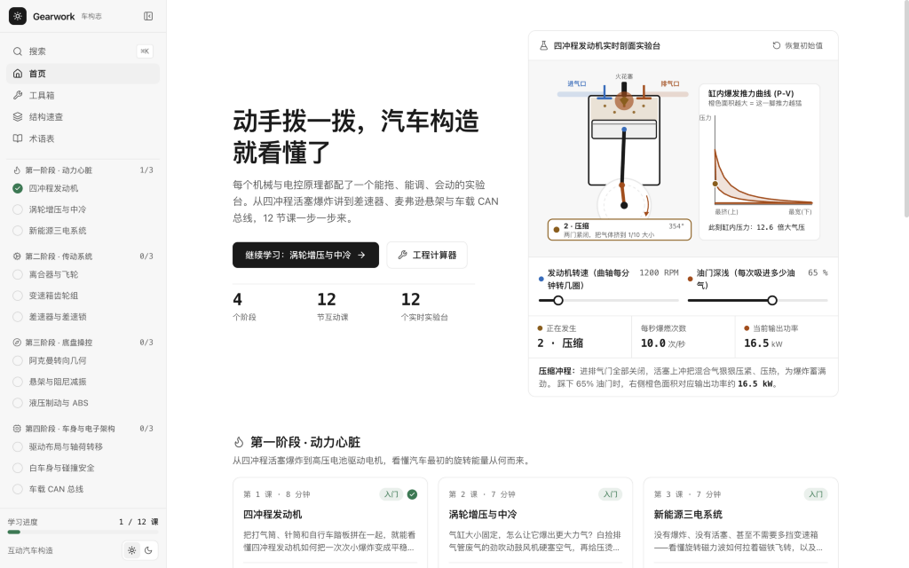
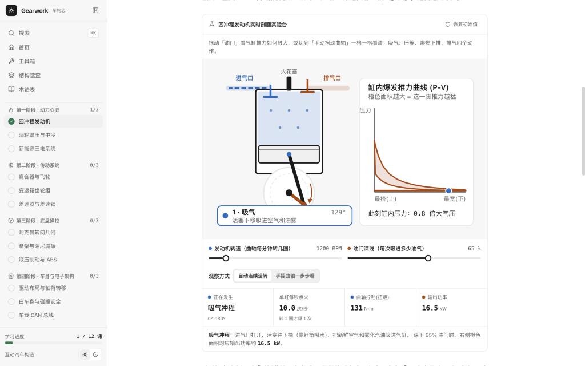
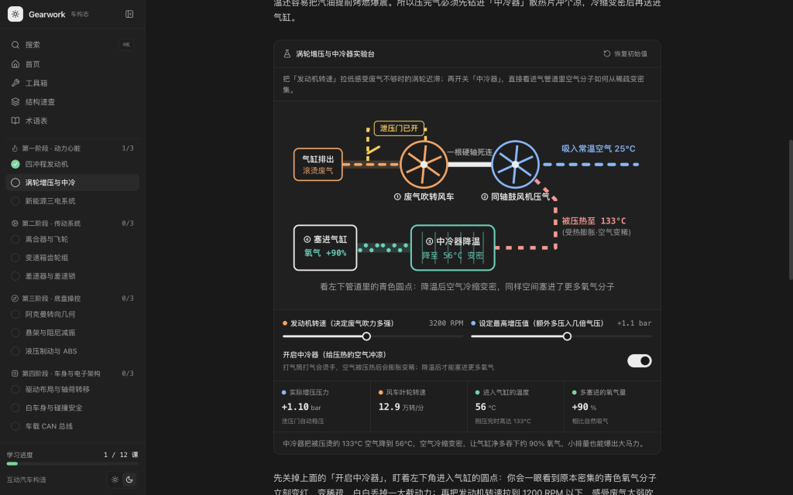

# interactive-explainer-site

用于指导 AI 编码助手（如 Antigravity、Claude Code、Codex）构建交互式原理科普与工程教学网站的 Skill。适合面向初学者的机械、电子、航空、物理等技术专题站点，参考 Ohmwork 与 Gearwork 的页面结构与视觉风格。

## 示例效果

以下截图来自使用本 Skill 构建的汽车构造科普站 Gearwork（车构志）：

### 首页布局与内嵌实验台（浅色模式）



### 交互式 SVG 实验台（浅色模式）



### 交互式 SVG 实验台（深色模式）



## 包含内容

本 Skill 将建站过程拆为 4 个阶段，并在 `references/` 中按主题拆出参考文档，按需读取，不依赖单段长提示词：

- **教学结构**：按阶段组织课程路线图，每课包含生活类比、16:9 导学动画、原理拆解、可调参实验台和随堂自测，并配套工程计算器、结构速查与术语表。
- **视觉与样式**：采用浅色与深色双主题的中性界面，彩色仅用于区分物理量与状态，附完整的 Tailwind CSS v4 `@theme inline` 样式模板。
- **内联 SVG 交互**：全部动画由 React 状态与 `requestAnimationFrame` 驱动，不使用 Canvas；图形变化、滑块数值与底部结论共用同一数据源。
- **常见问题与检查项**：收录实际开发中的布局、SVG 防重叠与深浅色对比度问题，并附桌面、折叠侧栏、深色模式及移动端的 4 视口检查清单。

## 目录结构

```text
interactive-explainer-site/
├── SKILL.md                                # 主流程、写作约束与项目启动模板
├── assets/                                 # README 示例截图
└── references/
    ├── design-system.md                    # 样式规范、语义色板与 index.css 模板
    ├── architecture-and-components.md      # 目录结构、页面模板与核心组件契约
    └── svg-labs-and-qa.md                  # SVG 交互设计、避坑记录与多视口检查清单
```

## 安装

### 全局安装（Antigravity）

```bash
git clone git@github.com:hujunalex1/interactive-explainer-site-skill.git \
  ~/.gemini/config/skills/interactive-explainer-site
```

### 项目级安装

```bash
git clone git@github.com:hujunalex1/interactive-explainer-site-skill.git \
  .agents/skills/interactive-explainer-site
```

## 使用方式

安装后，在对话中给出 4 至 5 行主题说明即可调用本 Skill：

```text
请使用 interactive-explainer-site 技能，创建一个介绍「飞机飞行原理与航空构造」的交互式科普网站。
- 品牌名：Airframe（翼构志）
- 目标读者：零基础航空爱好者
- 课程规模：4 阶段共 12 课（含计算器、部件速查与术语表）
- 重点互动实验：机翼伯努利与迎角失速、涡扇发动机气流循环、副翼/升降舵/方向舵三轴姿态、起落架减震与反推制动
```
